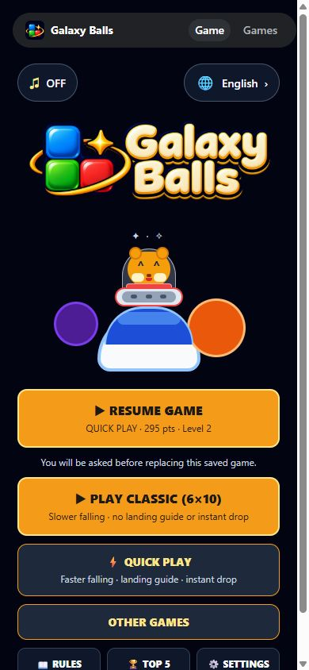
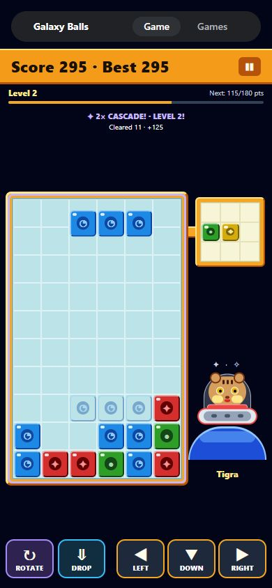
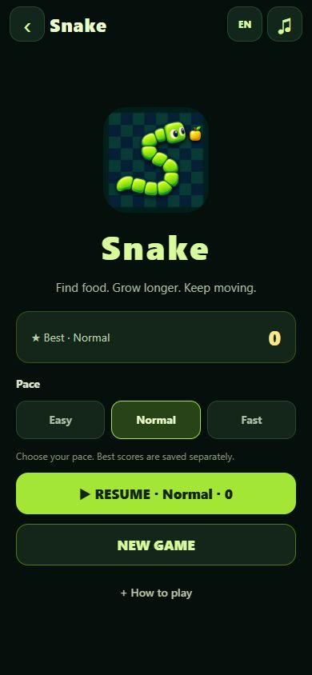

<p align="center">
  
</p>

<p align="center">Galaxy Balls and Snake — two arcade classics for mobile and web.</p>

<p align="center">
  <a href="#how-to-play">How to play</a> ·
  <a href="#screenshots">Screenshots</a> ·
  <a href="#run-locally">Run locally</a> ·
  <a href="docs/architecture.md">Folder guide</a>
</p>

## How to play

**Galaxy Balls**

Match colors, trigger cascades, and keep the board from filling up.

| Mode | Falling speed | Landing guide | Instant drop |
| --- | --- | --- | --- |
| **Classic** | Slower | — | — |
| **Quick Play** | Faster | ✓ | ✓ |

Hold **◀ ▼ ▶** to move. Tap **↻** to rotate; **⇓** drops instantly in Quick Play.

**Snake** — open **Other Games**, eat the gold food, and avoid walls and your tail.
Choose Easy, Normal, or Fast; steer with the right-side arrows, swipes, or keyboard.
[Controls & saves →](docs/snake.md)

- **Languages:** English · አማርኛ · Afaan Oromoo
- **Audio:** menu music and effects, with separate controls
- **Progress:** saved runs, local high scores, and a confirmation before replacing a game
- **Settings:** vibration, block symbols, and rotation preferences

## Screenshots

Click a screenshot to open it full size.

<p align="center">
  <a href="docs/images/home.jpg"></a>
  <a href="docs/images/gameplay.jpg"></a>
  <a href="docs/images/snake.jpg"></a>
</p>

## Run locally

```sh
npm install
npm run web
```

For mobile development, run `npm start`.

<details>
<summary><strong>What gets saved?</strong></summary>

Each game keeps its own unfinished run and scores on this device. Galaxy Balls
keeps a top-five table; Snake keeps a best score for each speed. Language and
audio settings are shared. Reopen a game and choose **Resume** to continue.

Starting another run asks before replacing a saved game. Clearing app or browser
data removes local saves.

</details>

<details>
<summary><strong>Developer commands & notes</strong></summary>

```sh
npm run lint
npx tsc --noEmit
npm test
```

- Game-only tests: `npm run test:galaxy-balls`
- Snake tests: `npm run test:snake`
- Rebuild sounds: `npm run sounds:build` / `npm run sounds:snake`
- Launcher icons and splash changes need a new native build.

[Project structure & adding games](docs/architecture.md) · [Artwork](assets/branding/README.md) · [Font license](assets/fonts/OFL.txt)

</details>
