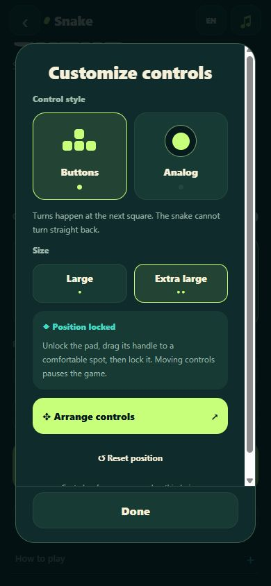
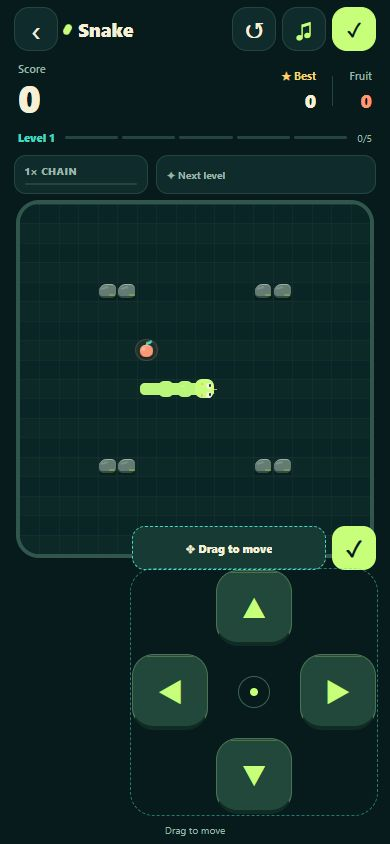
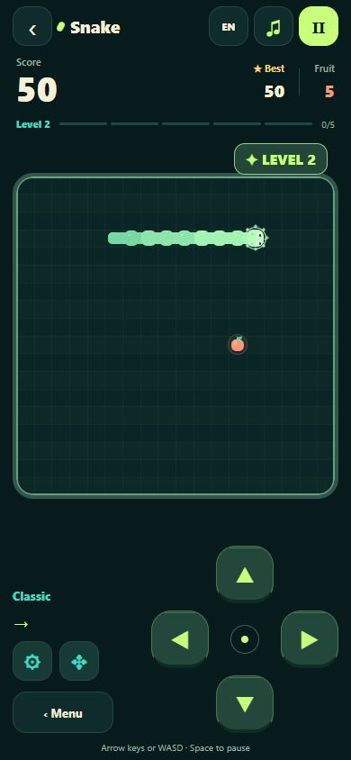

# Snake

Open **Other Games → Snake** and choose your garden.

| Garden | What to expect |
| --- | --- |
| **Classic** | An open board, 10 points per fruit, and familiar Snake rules. |
| **Arcade** | Rock hazards, quick-pickup chains up to 3× points, and timed golden fruit. |

Coral fruit grows the snake. In Arcade, every five fruits reveals a golden fruit
worth **50 points** without extra growth. Catch it before its bar runs out.
The chain and golden-fruit timers freeze while paused.

Walls, your body, and Arcade rocks end the run. Fill every available cell to win.

| Control | Action |
| --- | --- |
| Large arrows, analog stick, or a board swipe | Turn |
| Arrow keys / WASD | Turn on web |
| Space / P | Pause or resume on web |
| Escape | Pause on web |
| Ⅱ / ▶ in the header | Pause or resume |

Open **Controls** from the menu, pause card, or the gear beside the pad. Choose
**Buttons** or **Analog**, then **Large** or **Extra large**.

To move the pad, choose **Arrange controls** (or tap **✥** beside it). Play pauses.
Drag its handle, then tap **✓** to lock the position. On web, arrow keys also move
the unlocked pad. **↺** resets it to the bottom right. Arranging from the menu
uses a preview and keeps your saved run.

Style, size, position, and lock state are saved on this device. Starting or
resuming a run locks the pad. During countdown, you can choose your first turn;
the snake starts moving when the countdown finishes.

<details>
<summary>See the control options and movable pad</summary>

<p>
  <a href="images/snake-controls.jpg"></a>
  <a href="images/snake-controls-layout.jpg"></a>
</p>

</details>

Easy, Normal, and Fast start at different speeds. Every five foods speeds up the
snake. A countdown gives you time to prepare when starting or resuming.

Each berry has a soft pop. Every five berries adds a rising chime, a brief sparkle
burst, and a new snake tint. The earned color returns with your saved run;
reduced-motion settings skip the burst.

<details>
<summary>See a level-up</summary>

<a href="images/snake-level-up.jpg"></a>

</details>

Your run and best score for each garden and speed save automatically. Leaving the screen,
switching apps, or hiding the browser pauses play. After reopening, choose
**Resume**. Starting a new run asks before replacing an unfinished one.
Existing Classic runs and scores remain available after the update.

Language, sound, and vibration follow the shared settings. Saves use the separate
`@snake/game-data` key and do not replace Galaxy Balls progress.

```sh
npm run test:snake
npm run sounds:snake
```
